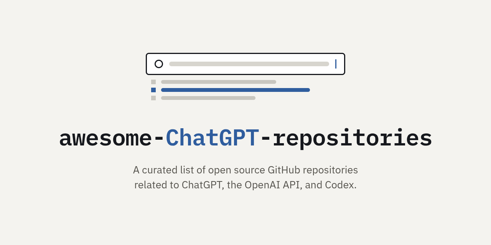

# awesome-ChatGPT-repositories

  

A curated list of resources dedicated to open source GitHub repositories related to [ChatGPT](https://openai.com/blog/chatgpt).
A tool for searching these repositories is [available](https://huggingface.co/spaces/taishi-i/awesome-ChatGPT-repositories-search) on Hugging Face Spaces.

Your contributions are always welcome! Before contributing, please read [the guidelines](https://github.com/taishi-i/awesome-ChatGPT-repositories/blob/main/contributing.md).

## Claude Code & Codex Skill

Search 2,500+ curated repositories directly from Claude Code or Codex — no browser needed, just describe what you're looking for. Both tools use the same skill and the same bundled data.

- **Find tools by topic** — RAG frameworks, agent libraries, chatbot UIs, CLI tools, and more
- **Filter by category or language** — narrow results to a specific category (e.g. `CLIs`, `NLP`) or programming language
- **Multilingual queries** — search in Japanese, Chinese, Korean, or any language
- **Scored results** — ranked by relevance, star count, and project quality
